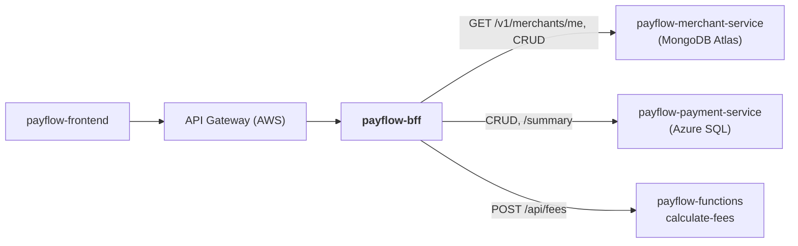

# payflow-bff

**Backend for Frontend do PayFlow** em **Node.js**. É o único backend que o
microfrontend consome (sempre através do API Gateway). Ele agrega dados dos
microsserviços e da Azure Function e faz o proxy do CRUD.

Parte da plataforma PayFlow (arc42 completo no repositório de documentação
[`PayFlow`](https://github.com/CaioSeniuk/PayFlow)). Alunos: **Caio Henrique,
Gabriel Moribe, Guilherme Celente e Leonardo Berlanda** — PUCPR, Arquitetura de
Soluções com Cloud, 2026.

## O que é este repositório

O BFF do **portal do lojista**. Responsabilidades:

1. **Agregação**: `GET /aggregated-data`, o endpoint obrigatório da atividade. Consulta o
   merchant-service (MongoDB), o payment-service (Azure SQL) e a Azure Function
   `calculate-fees`, e devolve **um único JSON**.
2. **Proxy CRUD** de lojistas e pagamentos, adaptado às telas.
3. **Autenticação do lojista**: valida `X-Merchant-Key` no merchant-service e injeta
   o `merchantId` nas chamadas seguintes. O `merchantId` nunca vem do frontend.

## Relação com os outros repositórios



| Repositório | Relação |
|---|---|
| `payflow-frontend` | Cliente: chama `/api/*` no API Gateway, que roteia para este BFF. |
| `payflow-merchant-service` | Autenticação do lojista, dados do lojista e CRUD. |
| `payflow-payment-service` | Resumo, últimos pagamentos e CRUD. |
| `payflow-functions` | `calculate-fees` (HTTP Trigger) para enriquecer o painel. |

## Tecnologias

| Item | Escolha |
|---|---|
| Runtime / linguagem | Node.js 22 LTS, TypeScript 6 (ESM) |
| Framework HTTP | Express 5 |
| Validação | zod 4 (corpo, query e variáveis de ambiente) |
| Cliente HTTP | `fetch` nativo com `AbortSignal.timeout` (2 s no painel, 10 s no proxy) |
| Documentação | OpenAPI 3.1 + swagger-ui-express (`/docs/`) |
| Logs | pino + pino-http (JSON, `X-Correlation-Id`, chaves mascaradas) |
| Testes | Vitest (unitários), Supertest (API), dependency-cruiser (arquitetura) |
| Qualidade | ESLint (typescript-eslint), `tsc --noEmit` |
| Contêiner | Dockerfile multi-stage (`node:22-alpine`, usuário não root) |
| CI | GitHub Actions: lint, typecheck, testes e build em todo push; imagem no Docker Hub em tags `v*` |
| Registro | Docker Hub: `docker.io/<dockerhub-user>/payflow-bff:<tag>` |
| Execução na nuvem | Azure Container Apps (`ca-payflow-bff`) atrás do Amazon API Gateway |

## Arquitetura interna (Clean Architecture + Vertical Slice)

| Camada | Pasta | Conteúdo |
|---|---|---|
| Domain | `src/domain/` | Tipos `Dashboard`, `PaymentSummary`, `Fees`, `AuthenticatedMerchant`, porta `MerchantAuthenticator`, regras puras de agregação (`buildDashboard`, avisos) e erros |
| Application | `src/features/<fatia>/handler.ts`, `ports.ts` | Caso de uso e interfaces dos clientes de que a fatia precisa |
| API | `src/features/<fatia>/route.ts`, `src/api/` | Rotas Express, middlewares (auth, gateway, erros, correlation-id), app, Swagger |
| Infrastructure | `src/infrastructure/` | `MerchantClient`, `PaymentClient`, `FeesClient`, `ServiceHttpClient`, config/env |

```text
src/
├── domain/                 dashboard.ts, merchant.ts, context.ts, errors.ts
├── features/
│   ├── aggregated-data/    GET /aggregated-data
│   ├── merchants-proxy/    /merchants/**
│   └── payments-proxy/     /payments/**
├── infrastructure/
│   ├── clients/            http.ts, merchant-client.ts, payment-client.ts, fees-client.ts
│   └── config.ts
├── api/
│   ├── app.ts              composição: middlewares + rotas, recebe os clientes como portas
│   ├── middlewares/        auth, gateway-secret, correlation-id, errors
│   ├── docs.ts
│   └── openapi.yaml
└── server.ts               lê o ambiente, cria os clientes e sobe o app
```

Regras do dependency-cruiser (testes de arquitetura, rodam no `npm test`):

1. `domain` não importa nada de fora de `domain` (nem Express, nem APIs do Node, nem pacotes npm).
2. Uma fatia não importa outra.
3. `features` não importa `infrastructure`: recebe as portas por injeção em `api/app.ts`.
4. `handler.ts` e `ports.ts` não importam framework nem pacote nenhum.
5. `infrastructure` só implementa as portas; não usa rotas, handlers nem a camada `api`.
6. Sem dependências circulares ou imports que não resolvem.

## Endpoints

Todas as rotas passam pelo API Gateway (`<gateway>/api/...`). Autenticação:
**lojista** = `X-Merchant-Key`; **admin** = `X-Admin-Key` (`ADMIN_KEY`; sem ela,
a administração responde 404).

| Método | Rota | Autenticação | Descrição |
|---|---|---|---|
| GET | `/aggregated-data` | lojista | Painel: lojista + resumo + últimos 5 pagamentos + taxas |
| GET | `/merchants/me` | lojista | Dados do lojista autenticado |
| PUT | `/merchants/me` | lojista | Altera nome e e-mail (o status fica como está) |
| PUT | `/merchants/me/webhook` | lojista | Configura o webhook (sem `secret`, um é gerado e devolvido) |
| POST | `/merchants/me/api-key` | lojista | Gera nova chave; a anterior deixa de funcionar na hora |
| POST | `/merchants` | — | Cadastro de lojista; devolve a API key uma única vez |
| GET | `/merchants` | admin | Lista lojistas (`status`, `page`, `size`) |
| GET/PUT/DELETE | `/merchants/{id}` | admin | Detalha, altera (nome, e-mail, status) e remove |
| POST | `/payments` | lojista | Cria pagamento; exige `Idempotency-Key`, repassado ao payment-service |
| GET | `/payments` | lojista | Lista (`status`, `method`, `from`, `to`, `page`, `size`) |
| GET/PATCH/DELETE | `/payments/{id}` | lojista | Detalha, altera descrição/metadados, cancela |
| POST | `/payments/{id}/refunds` | lojista | Estorno total ou parcial; exige `Idempotency-Key` |
| POST | `/payments/{id}/pix-confirmation` | lojista | Simula confirmação PIX |
| GET | `/health` | — | Health check (fora da checagem do Gateway) |
| GET | `/docs/` | — | Swagger (documento em `/docs/openapi.json`) |

Comportamento comum:

- As respostas dos serviços chegam ao frontend como vieram (status, corpo e
  `Content-Type`, inclusive os erros em Problem Details). O `Location` é reescrito para
  a rota do BFF (`/v1/payments/{id}` → `/payments/{id}`), e `Retry-After` e
  `Idempotent-Replayed` são repassados.
- O BFF responde por conta própria: 400 para formato inválido (lista os campos), 401
  sem chave válida, 403 sem o segredo do Gateway, 404 para rota inexistente, 502 quando
  um serviço não responde e 504 quando passa do tempo.
- Todo pedido aos serviços leva `X-Correlation-Id` (o recebido ou um novo), devolvido
  também na resposta.

### `GET /aggregated-data`

```json
{
  "merchant": { "id": "…", "name": "Loja Exemplo", "webhookConfigured": true },
  "summary": { "currency": "BRL", "totalAmount": 125000, "count": 42,
               "byStatus": { "AUTHORIZED": 30, "PENDING": 5 }, "byMethod": { "CARD": 90000, "PIX": 35000 } },
  "recentPayments": [ { "id": "…", "amount": 1990, "currency": "BRL", "method": "PIX",
                        "status": "CONFIRMED", "createdAt": "…" } ],
  "fees": { "totalFees": 3488, "netAmount": 121512,
            "byMethod": [ { "method": "CARD", "gross": 90000, "rate": 0.0349, "fee": 3141, "settlement": "D+30" } ] },
  "warnings": [],
  "generatedAt": "2026-11-10T14:00:00.000Z"
}
```

Resumo e últimos pagamentos são pedidos **em paralelo** ao payment-service. As taxas
vêm **depois do resumo**, porque a Function recebe o `byMethod` dele. Uma parte que
falha vem `null` e ganha um item em `warnings`:

```json
{ "part": "fees", "dependency": "calculate-fees", "reason": "timeout",
  "message": "calculate-fees did not answer in 2000 ms" }
```

`reason`: `timeout`, `unreachable`, `not-configured` (sem `FEES_FUNCTION_URL`),
`bad-response` ou `skipped` (taxas sem resumo). Só a falha de autenticação do lojista
interrompe a resposta.

## Estado atual

- [x] Projeto TypeScript (Express 5, ESLint, Vitest), Dockerfile e `compose.yaml`
- [x] Middleware de autenticação do lojista, do Gateway e de `X-Correlation-Id`
- [x] Clientes HTTP com timeout
- [x] Fatia `aggregated-data` com testes unitários (clientes simulados)
- [x] Fatias de proxy (lojistas e pagamentos) e administração com `X-Admin-Key`
- [x] OpenAPI + swagger-ui
- [x] Regras dependency-cruiser executadas no `npm test`
- [x] GitHub Actions
- [ ] Rodar ponta a ponta com os serviços e a Function locais
- [ ] Publicar `v1` no Docker Hub e implantar no Container Apps
- [ ] Configurar rota no API Gateway

## Como rodar localmente

Pré-requisitos: Node.js 22 (`nvm use` lê o `.nvmrc`) e, para os serviços, Docker.

```bash
# 1. Serviços (cada um no seu repositório)
cd ../payflow-merchant-service && docker compose up -d      # http://localhost:8081
cd ../payflow-payment-service  && docker compose up -d      # http://localhost:8082

# 2. BFF
cd ../payflow-bff
cp .env.example .env
npm install
npm run dev          # http://localhost:3000/docs/
```

Ou o BFF em contêiner (alcança os serviços pelo host): `docker compose up -d --build`.

Sem a Function (`FEES_FUNCTION_URL` vazio), o painel responde com `fees: null` e um
aviso. Com `GATEWAY_ORIGIN_SECRET` vazio, o BFF aceita requisições diretas (só em
desenvolvimento).

```bash
B=http://localhost:3000
curl -X POST $B/merchants -H 'Content-Type: application/json' \
  -d '{"name":"Loja Teste","email":"loja@teste.com","document":"98765432000110"}'   # guarde o apiKey
K=<apiKey>
curl $B/aggregated-data -H "X-Merchant-Key: $K"
curl -X POST $B/payments -H "X-Merchant-Key: $K" -H 'Idempotency-Key: pedido-1' \
  -H 'Content-Type: application/json' -d '{"amount":1990,"method":"CARD","cardToken":"tok_approved"}'
```

Testes e qualidade:

```bash
npm test             # arquitetura (dependency-cruiser) + unitários e API (Vitest)
npm run lint
npm run typecheck
npm run build        # dist/
```

### Variáveis de ambiente

| Variável | Descrição |
|---|---|
| `PORT` | Padrão `3000` |
| `MERCHANT_SERVICE_URL` | URL base do merchant-service |
| `PAYMENT_SERVICE_URL` | URL base do payment-service |
| `FEES_FUNCTION_URL` | URL de `calculate-fees` (opcional; sem ela as taxas vêm `null` com aviso) |
| `FEES_FUNCTION_KEY` | Function key (segredo) |
| `INTERNAL_KEY` | `X-Internal-Key` dos microsserviços, 32 a 256 caracteres (segredo, obrigatória) |
| `GATEWAY_ORIGIN_SECRET` | Cabeçalho que o API Gateway envia; requisições sem ele são recusadas (segredo; vazio = desligado) |
| `ADMIN_KEY` | `X-Admin-Key` da administração de lojistas (segredo; vazio = desligada) |
| `CORS_ORIGIN` | Origens do frontend, separadas por vírgula (desenvolvimento local) |
| `UPSTREAM_TIMEOUT_MS` | Timeout do painel e da autenticação; padrão `2000` |
| `PROXY_TIMEOUT_MS` | Timeout das rotas de proxy; padrão `10000` |
| `LOG_LEVEL` | Padrão `info` |

Os valores do `.env.example` são só para desenvolvimento local; o `INTERNAL_KEY` é o
mesmo dos serviços. Uma variável inválida impede o start e é nomeada no erro, sem
mostrar o valor.

## API Gateway (Amazon API Gateway REST)

A configuração do gateway fica documentada aqui por ser a porta de entrada deste BFF:

- API `payflow-api`, stage `prod`, recurso `/api/{proxy+}` com integração HTTP proxy para `https://<ca-payflow-bff>/{proxy}`.
- Cabeçalho fixo `X-Gateway-Secret` adicionado na integração (`GATEWAY_ORIGIN_SECRET`).
- Usage plan com API key (`x-api-key`), throttling (rate 20 req/s, burst 40) e quota diária.
- CORS liberado só para o domínio do CloudFront do frontend.
- Swagger do BFF exposto também em `<gateway>/api/docs/` (os caminhos do Swagger são relativos e funcionam atrás do prefixo).

## Publicação

Pelo GitHub Actions: cadastre os segredos `DOCKERHUB_USERNAME` e `DOCKERHUB_TOKEN` no
repositório e crie uma tag:

```bash
git tag v1 && git push origin v1   # publica docker.io/<usuario>/payflow-bff:v1
```

Ou manualmente:

```bash
docker buildx build --platform linux/amd64 \
  -t docker.io/<dockerhub-user>/payflow-bff:v1 --push .
```

## Links

| Item | URL |
|---|---|
| Swagger (via Gateway) | _a publicar_ |
| API Gateway | _a publicar_ |
| Docker Hub | _a publicar_ |
| Documentação de arquitetura | https://github.com/CaioSeniuk/PayFlow |
