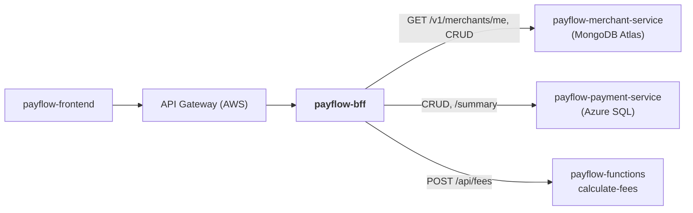

# payflow-bff

**Backend for Frontend do PayFlow** em **Node.js**. É o único backend que o
microfrontend consome (sempre através do API Gateway). Ele agrega dados dos
microsserviços e da Azure Function e faz o proxy do CRUD.

Parte da plataforma PayFlow (arc42 completo no repositório de documentação
[`PayFlow`](https://github.com/CaioSeniuk/PayFlow)). Alunos: **Caio Henrique,
Gabriel Moribe, Guilherme Celente e Leonardo Berlanda** — PUCPR, Arquitetura de
Soluções com Cloud, 2026.

## O que é este repositório

O BFF do **portal do lojista**. Responsabilidades:

1. **Agregação**: `GET /aggregated-data`, o endpoint obrigatório da atividade. Consulta o
   merchant-service (MongoDB), o payment-service (Azure SQL) e a Azure Function
   `calculate-fees`, e devolve **um único JSON**.
2. **Proxy CRUD** de lojistas e pagamentos, adaptado às telas.
3. **Autenticação do lojista**: valida `X-Merchant-Key` no merchant-service e injeta
   o `merchantId` nas chamadas seguintes. O `merchantId` nunca vem do frontend.

## Relação com os outros repositórios



| Repositório | Relação |
|---|---|
| `payflow-frontend` | Cliente: chama `/api/*` no API Gateway, que roteia para este BFF. |
| `payflow-merchant-service` | Autenticação do lojista, dados do lojista e CRUD. |
| `payflow-payment-service` | Resumo, últimos pagamentos e CRUD. |
| `payflow-functions` | `calculate-fees` (HTTP Trigger) para enriquecer o painel. |

## Tecnologias

| Item | Escolha |
|---|---|
| Runtime / linguagem | Node.js 20, TypeScript |
| Framework HTTP | Express 4 |
| Validação | zod |
| Cliente HTTP | `fetch` nativo com `AbortController` (timeout de 2 s) |
| Documentação | OpenAPI 3 + swagger-ui-express (`/docs`) |
| Logs | pino (JSON, `X-Correlation-Id`) |
| Testes | Vitest (unitários), Supertest (API), dependency-cruiser (arquitetura) |
| Contêiner | Dockerfile multi-stage (`node:20-alpine`, usuário não root) |
| Registro | Docker Hub: `docker.io/<dockerhub-user>/payflow-bff:<tag>` |
| Execução na nuvem | Azure Container Apps (`ca-payflow-bff`) atrás do Amazon API Gateway |

## Arquitetura interna (Clean Architecture + Vertical Slice)

| Camada | Pasta | Conteúdo |
|---|---|---|
| Domain | `src/domain/` | Tipos `Dashboard`, `MerchantView`, `PaymentView`, regras puras de agregação |
| Application | `src/features/<fatia>/handler.ts`, `ports.ts` | Caso de uso e interfaces dos clientes de que a fatia precisa |
| API | `src/features/<fatia>/route.ts`, `src/api/` | Rotas Express, middlewares (auth, erros, correlation-id), app e swagger |
| Infrastructure | `src/infrastructure/` | `MerchantClient`, `PaymentClient`, `FeesClient`, config/env |

```text
src/
├── domain/
├── features/
│   ├── aggregated-data/   GET /aggregated-data
│   ├── merchants-proxy/   /merchants/**
│   └── payments-proxy/    /payments/**
├── infrastructure/
│   ├── clients/
│   └── config.ts
├── api/
│   ├── app.ts
│   ├── middlewares/
│   └── openapi.yaml
└── server.ts
```

Regras do dependency-cruiser (testes de arquitetura): `domain` não importa nada
de fora de `domain`; uma fatia não importa outra; `features` não importa
`infrastructure` (recebe as portas por injeção em `api/app.ts`).

## Endpoints previstos

| Método | Rota | Descrição |
|---|---|---|
| GET | `/aggregated-data` | Painel: lojista + resumo + últimos 5 pagamentos + taxas |
| GET/PUT | `/merchants/me` | Dados do lojista autenticado |
| PUT | `/merchants/me/webhook` | Configura webhook |
| POST/GET/PUT/DELETE | `/merchants`, `/merchants/{id}` | CRUD de lojistas (administração) |
| POST/GET | `/payments` | Cria (repassa `Idempotency-Key`) e lista |
| GET/PATCH/DELETE | `/payments/{id}` | Detalha, altera, cancela |
| POST | `/payments/{id}/refunds` | Estorno |
| POST | `/payments/{id}/pix-confirmation` | Simula confirmação PIX |
| GET | `/health` | Health check |
| GET | `/docs` | Swagger |

Exemplo de resposta de `/aggregated-data`:

```json
{
  "merchant": { "id": "…", "name": "Loja Exemplo", "webhookConfigured": true },
  "summary": { "totalAmount": 125000, "count": 42, "byStatus": { "AUTHORIZED": 30, "PENDING": 5 }, "byMethod": { "CARD": 90000, "PIX": 35000 } },
  "recentPayments": [ { "id": "…", "amount": 1990, "method": "PIX", "status": "CONFIRMED" } ],
  "fees": { "totalFees": 3488, "netAmount": 121512, "byMethod": [ { "method": "CARD", "rate": 0.0349, "settlement": "D+30" } ] },
  "warnings": [],
  "generatedAt": "2026-11-10T14:00:00Z"
}
```

As chamadas a payment-service e Function rodam em paralelo (`Promise.allSettled`).
Uma falha vira `null` + mensagem em `warnings`; só a falha de autenticação do
lojista interrompe a resposta.

## Estado atual

Repositório novo; nada implementado.

- [ ] Projeto TypeScript (Express, ESLint, Vitest), Dockerfile
- [ ] Middleware de autenticação do lojista e de `X-Correlation-Id`
- [ ] Clientes HTTP com timeout
- [ ] Fatia `aggregated-data` com testes unitários (clientes simulados)
- [ ] Fatias de proxy
- [ ] OpenAPI + swagger-ui
- [ ] Regras dependency-cruiser executadas no `npm test`
- [ ] Publicar `v1` no Docker Hub e implantar no Container Apps
- [ ] Configurar rota no API Gateway
- [ ] GitHub Actions

## Como rodar localmente (previsto)

```bash
cp .env.example .env
npm install
npm run dev          # http://localhost:3000/docs
npm test             # unitários + arquitetura
```

### Variáveis de ambiente

| Variável | Descrição |
|---|---|
| `PORT` | Padrão `3000` |
| `MERCHANT_SERVICE_URL` | URL base do merchant-service |
| `PAYMENT_SERVICE_URL` | URL base do payment-service |
| `FEES_FUNCTION_URL` | URL de `calculate-fees` |
| `FEES_FUNCTION_KEY` | Function key (segredo) |
| `INTERNAL_KEY` | `X-Internal-Key` para os microsserviços (segredo) |
| `GATEWAY_ORIGIN_SECRET` | Cabeçalho que o API Gateway envia; requisições sem ele são recusadas (segredo) |
| `CORS_ORIGIN` | Domínio do frontend (para desenvolvimento local) |

## API Gateway (Amazon API Gateway REST)

A configuração do gateway fica documentada aqui por ser a porta de entrada deste BFF:

- API `payflow-api`, stage `prod`, recurso `/api/{proxy+}` com integração HTTP proxy para `https://<ca-payflow-bff>/{proxy}`.
- Cabeçalho fixo `X-Gateway-Secret` adicionado na integração (`GATEWAY_ORIGIN_SECRET`).
- Usage plan com API key (`x-api-key`), throttling (rate 20 req/s, burst 40) e quota diária.
- CORS liberado só para o domínio do CloudFront do frontend.
- Swagger do BFF exposto também em `<gateway>/api/docs`.

## Publicação

```bash
docker buildx build --platform linux/amd64 \
  -t docker.io/<dockerhub-user>/payflow-bff:v1 --push .
```

## Links

| Item | URL |
|---|---|
| Swagger (via Gateway) | _a publicar_ |
| API Gateway | _a publicar_ |
| Docker Hub | _a publicar_ |
| Documentação de arquitetura | https://github.com/CaioSeniuk/PayFlow |
